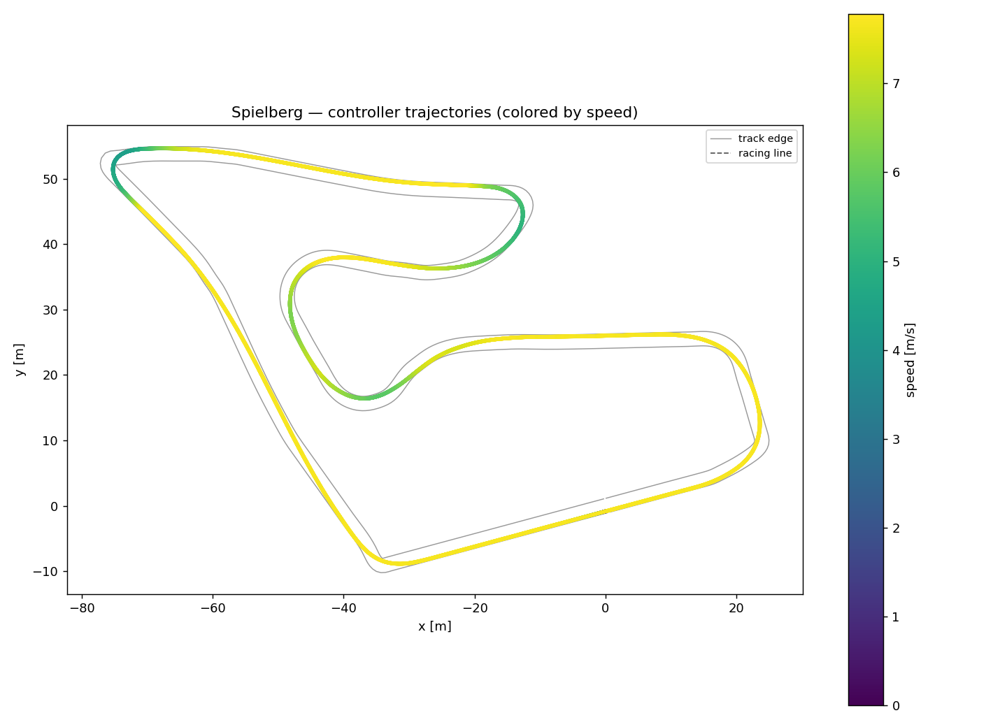

# Racer — High-Speed Autonomous Racing Control (F1TENTH)

A simulated autonomous racing stack tracking a pre-optimized racing line with
Model Predictive Control. The original high-speed benchmark is preserved below;
the online grip-estimation extension uses a conservative, separately validated
operating configuration.

Inspired by **Politecnico di Milano's [PoliMOVE](https://polimove.deib.polimi.it/)**
program — the team from PoliMI's AIDA lab that set the autonomous land-speed
record (~309 km/h) and won multiple [Indy Autonomous Challenge](https://www.indyautonomouschallenge.com/)
races. PoliMOVE's edge is *software*: perception, planning and control that push
a real race car to its physical limits. This project reproduces the heart of that
problem — **planning and control at the friction limit** — in the open-source
[F1TENTH](https://f1tenth.org/) simulator.

---

## The result — original kinematic controller

Benchmarked on the **Spielberg (Red Bull Ring)** track, 338 m lap:

| Controller | Lap time | Max speed | Mean speed | Max tracking error | Compute / step |
|---|---|---|---|---|---|
| Ideal racing line (perfect tracking) | **45.05 s** | 8.0 m/s | 7.6 m/s | — | — |
| Pure Pursuit (geometric baseline) | 57.85 s | 6.4 m/s | 5.8 m/s | 0.19 m | 0.15 ms |
| **Nonlinear MPC** | **47.22 s** | 7.8 m/s | 7.1 m/s | 0.20 m | ~9 ms |

**The MPC is 10.6 s (18.4%) faster than the tuned pure-pursuit baseline, and
laps within 4.8% (2.2 s) of the theoretical minimum-time racing line** — while
holding the car to within 20 cm of the line the entire lap.



Why the baseline is slower: pure pursuit is a purely *geometric* tracker. It
understeers and cuts corners, so it can only be pushed to ~80% of the racing-line
speed before it flies off the tight corners. The MPC plans steering **and** speed
together over a ~2 s horizon against a vehicle model, so it brakes and turns in
*ahead* of each corner and can carry the full-speed line.

---

## How it works

```
optimized racing line  ──►  MPC (receding horizon)  ──►  [steering, speed]  ──►  F1TENTH sim
 (x, y, ψ, curvature,        solve every 30 ms                                     (single-track
  target speed profile)      with CasADi + IPOPT                                    dynamic model)
```

### Vehicle model
The published benchmark above used a **kinematic bicycle model**. The grip
extension keeps state `[x, y, ψ, v]` and input `[steering, acceleration]`, with RK4,
and adds a **steady-state single-track approximation** for speed-dependent yaw
response and body slip. This is an equilibrium correction, not full transient
tyre dynamics. The nominal-friction approximation is fixed across comparison arms. Estimated
friction adjusts the lateral-acceleration budget and reference speeds; it does
not turn an uncertainty margin into a different predicted tyre stiffness. See [validation evidence](docs/VALIDATION_RESULTS.md)
for the regression that motivated the change.

### Optimal control problem (solved every tick)
Minimize, over a horizon of N = 25 steps (`dt` = 0.1 s ≈ 2.5 s preview):

- position error to the racing line,
- heading error (`1 − cos(ψ − ψ_ref)`, wrap-safe),
- speed error to the racing line's target profile,
- control effort and control-rate (smoothness),

subject to:

- vehicle dynamics (RK4 bicycle with steady-state yaw/slip correction),
- steering / acceleration / speed bounds and steering-rate limits,
- a **lateral-grip limit** on predicted acceleration (`|v·r_model| ≤ grip_frac·μg`,
  soft-constrained), encouraging the plan to respect a conservative cornering budget.

Only the first input is applied; the problem is re-solved at the next tick
(receding horizon). Solved with **CasADi + IPOPT**. The historical timing field
averages controller cost over physics steps, including held commands; it is not
mean latency per NLP solve. New experiment summaries label this explicitly.

### Engineering notes — the non-obvious failures
Getting an MPC to lap at the limit surfaced several classic pitfalls, each fixed
and documented in the code:

1. **Kinematic yaw-rate exploit.** In a kinematic bicycle, yaw rate = `v/L·tan δ`,
   so when steering saturates in a tight corner the optimizer *speeds up* to turn
   harder — planning 13 m/s and 26× the grip limit. Fixed with a one-sided
   penalty on exceeding the (grip-optimal) racing-line speed.
2. **Heading-wrap solver blow-ups.** When the measured heading wraps ±π, the
   warm-start guess became inconsistent with the new state and IPOPT converged to
   a full-lock "unwinding" solution that spun the car — the root cause of *every*
   crash observed. Fixed by feeding the controller a continuously-unwrapped
   heading and aligning the reference to the same branch.
3. **Reference spacing.** Reference points are spaced by the arc length the car
   *should* cover each step at the target speed (∫v dt), not by current speed —
   otherwise the reference collapses to a cluster at low speed and pins the car.
4. **Robust fallback.** On a rare non-convergence the controller brakes and holds
   the last good steering instead of trusting a bad iterate.

---

## Project layout

```
racer/
  config.py                 vehicle params, paths, sim constants
  raceline.py               load + query the optimized racing line
  runner.py                 episode loop, lap timing, metrics
  plotting.py               trajectory / speed plots
  controllers/
    base.py                 Controller interface + CarState
    pure_pursuit.py         Stage 1 — geometric baseline
    mpc.py                  Stage 2 — nonlinear MPC (CasADi/IPOPT)
scripts/
  run.py                    run one controller (optional --render)
  benchmark.py              compare controllers, print table, save plots
```

---

## Setup

Requires Python 3.9–3.12.

```bash
python -m venv .venv
# Windows:  .venv\Scripts\activate     |  Unix:  source .venv/bin/activate

# 1) the F1TENTH gym (v1.0.0 branch — the modern, gymnasium-based rewrite)
git clone -b v1.0.0 --depth 1 https://github.com/f1tenth/f1tenth_gym.git
pip install -e ./f1tenth_gym

# 2) this project's deps
pip install -r requirements.txt
```

Map assets (track + racing line) download automatically on first run. The v1.0.0
map database ships `Spielberg.yaml` while the loader expects `Spielberg_map.yaml`,
so after the first download make a one-time copy:

```bash
cp f1tenth_gym/maps/Spielberg/Spielberg.yaml \
   f1tenth_gym/maps/Spielberg/Spielberg_map.yaml
```

## Run it

```bash
# watch the MPC lap the track
python -m scripts.run --controller mpc --render

# watch the baseline
python -m scripts.run --controller pure_pursuit --render

# full benchmark + plots
python -m scripts.benchmark
```

---

## Roadmap
- Dynamic single-track model in the MPC (tire slip) to close the last ~7% to the
  ideal racing line.
- On-board racing line optimization (minimum-curvature) instead of the shipped
  profile.
- Head-to-head with a second agent (overtaking) — the actual IAC problem.

## Credits
- [F1TENTH Gym](https://github.com/f1tenth/f1tenth_gym) — simulation environment.
- Racing lines generated with the F1TENTH map database (TUM minimum-time
  trajectory optimization).
- Inspired by Politecnico di Milano's PoliMOVE / AIDA lab.

## Online grip estimation

The grip-estimation upgrade adds a motion-based EKF, runtime MPC grip
adaptation, measured-data replay, and a dry/wet experiment harness. See the
[implementation plan](docs/IMPLEMENTATION_PLAN.md),
[estimator status and limitations](docs/GRIP_ESTIMATION.md#implementation-status-2026-11-11),
and [environment setup notes](docs/ENVIRONMENT.md).
Run the reproducible validation and experiments from this repository:

```bash
python -m scripts.prepare_map --map Spielberg
python -m pytest tests -q
python -m scripts.validate_grip --out-dir results/synthetic_grip --seed 7
python -m scripts.grip_experiment --surface dry --out results/grip_dry
python -m scripts.grip_experiment --surface wet --out results/grip_wet
```

Each simulation comparison saves motion CSVs, environment metadata, controller
summaries and a friction/speed/tracking-error plot. The GitHub Actions workflow
runs the solver tests, synthetic check, corrected baseline and dry/wet comparisons,
then uploads evidence as artifacts.

The checked-in [synthetic summary](results/synthetic_grip/summary.json) records
steady wet-segment friction RMSE 0.0175 and wet settling time 1.91 s for seed 7.
These are matched-model results, separate from the full simulator validation.
[GitHub Actions validation](https://github.com/fauzan111/High-Speed-Autonomous-Racing-Control-F1TENTH-/actions/runs/43207169981)
passed **50 tests** and every required dry/wet completion check:

| Surface | Fixed-dry MPC | Fixed-wet MPC | Adaptive MPC |
|---|---:|---:|---:|
| Dry | 65.16 s | 86.58 s | 69.59 s |
| Wet patch, mu=0.8 | 65.21 s | 74.76 s | 73.05 s |
| Wet patch, mu=0.6 | 65.22 s | 86.61 s | 77.66 s |

The extension uses a conservative **0.70 speed cap** and is slower than the
original free-slack MPC. Adaptive MPC beats the uniformly conservative fixed-wet
policy by 10.3% in the stronger-wet trial, but fixed-dry remains fastest and also
finishes. These deterministic experiments do not establish a safety advantage.
See [complete results, failed calibrations and limitations](docs/VALIDATION_RESULTS.md)
for estimator errors, policy settings and artifact locations. The simulator uses
a linear tyre-response parameter; this is not real-world peak-grip validation.
